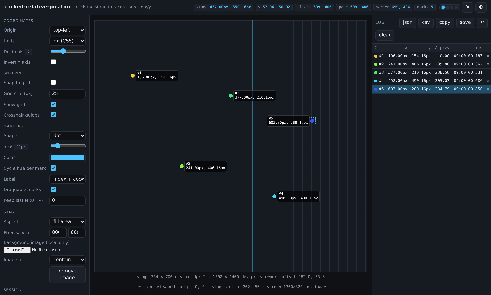
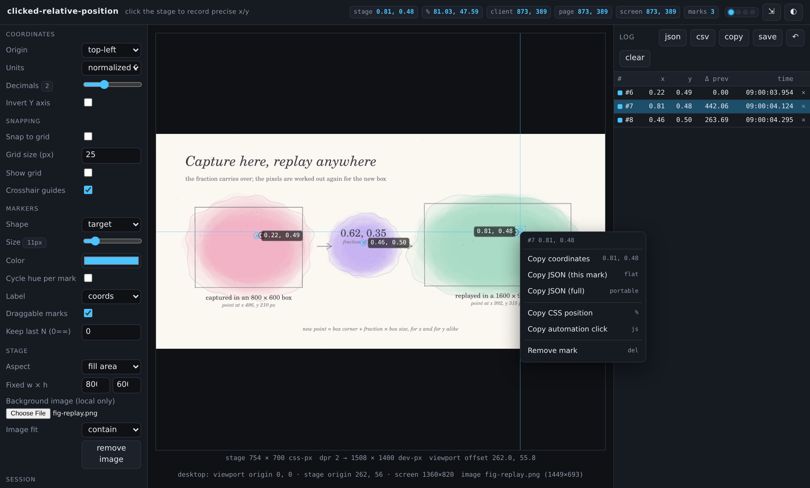
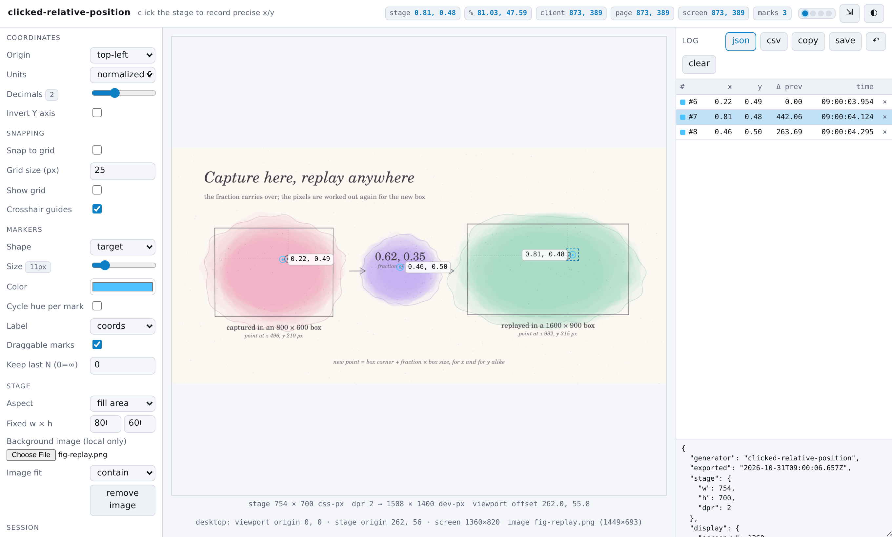
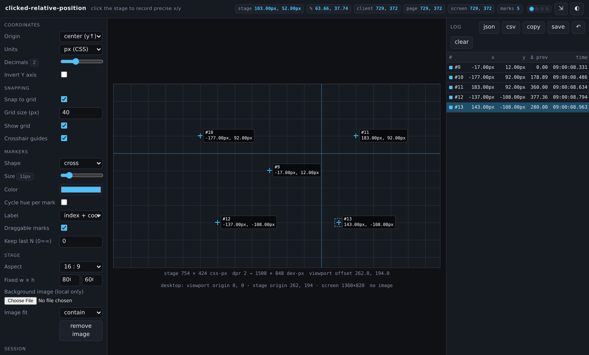
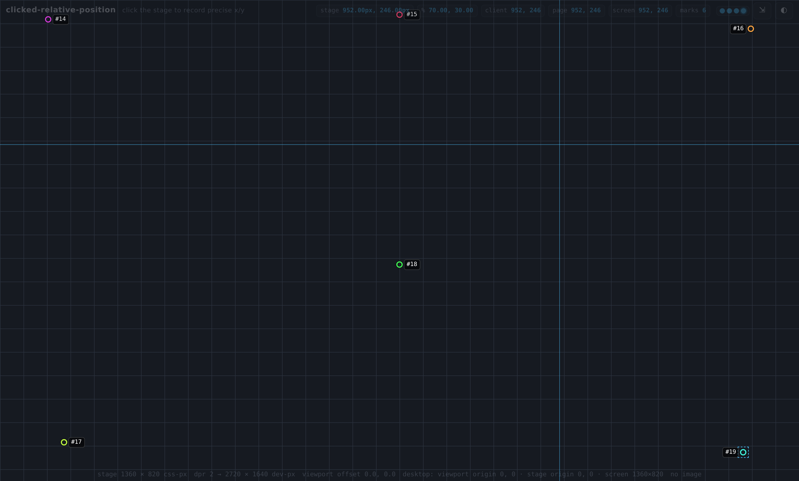
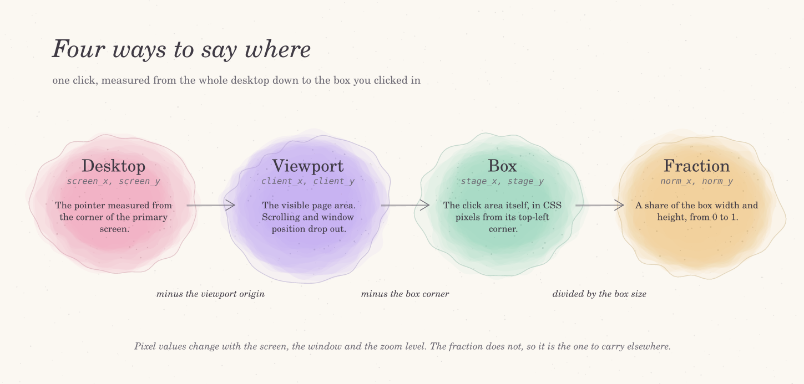
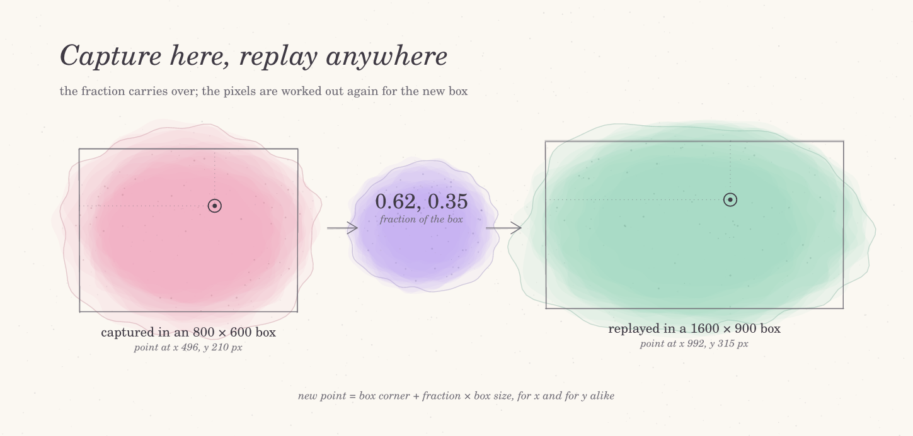

# Clicked Relative Position

Click anywhere and get the exact position of that click. This free online
click coordinate picker records the x and y of every click relative to a
box, in CSS pixels, percent, 0 to 1 fractions or device pixels. Drop a
screenshot or a mockup onto it to find pixel positions on an image, keep a
numbered log of every point, and export the whole set as JSON or CSV.

Use it online at <https://html-js.github.io/clicked-relative-position/>
or download `index.html` and open it straight from disk. It is a single
static page. There is no sign-up, no install and no build step, and every
measurement stays inside your browser.



<details>
<summary>More screenshots: measuring on an image, export panel, grid snapping, full-page mode</summary>

Points picked on a loaded picture, with the right-click menu open on one
of them.



The light theme with the JSON export open under the log.



A 16:9 stage with the origin in the center and snapping to a 40 px grid.



Full-page mode, where both side panels are gone and the top bar turns
into a faint overlay you can click through.



</details>

## What can you use it for?

Designers use it to read off where an element sits in a mockup, as a proportion
of the frame rather than a pixel count that only holds at one size.
Developers use it to find the coordinates for an image map hotspot or a
background position, or to measure the gap between two points on screen.

People writing browser automation use it to get a click position inside an
element that still works when the window is a different size. Researchers
and teachers use it to collect point coordinates from a photo, a chart or
a scanned page, then pull them into a spreadsheet. Testers use it to check
what coordinates a pen, a touch screen or a mouse actually reports.

If you have ever asked "what are the x y coordinates of this spot", "how
do I get the mouse position relative to a div", or "how far across this
image is that point in percent", this page answers it by clicking.

## How to get the x and y coordinates of a click

1. Open the page. The large dark area in the middle is the stage, the box
   every coordinate is measured against.
2. Move the pointer over it. The chips in the top bar show the live
   position before you commit to anything.
3. Click. A numbered mark appears where you clicked, and a new row lands
   in the log on the right.
4. Keep clicking to add more points. The log shows each one with its x
   and y, its distance from the point before it, and the time it was taken.
5. Copy what you need. Right-click a mark for a menu of copy formats, or
   use the buttons above the log to copy or save the whole list.

The live readout in the top bar shows more than one space at once. The
first chip is the position in your chosen units. Next to it is the
position as a percentage of the stage. Then come the pointer position in
the visible page area, the position on the page including scroll, and the
position on the whole desktop. On narrow windows the less important chips
hide themselves so the bar stays on one row.

## Find pixel coordinates on an image

Under "Stage" in the left panel, choose a picture with "Background image".
It is drawn inside the stage, and every click on it is measured as usual.
The image is read locally by your browser. It is never uploaded, and it is
not kept after you reload the page.

"Image fit" decides how the picture fills the stage. "contain" shows the
whole image with empty bands at the sides, "cover" fills the stage and
crops the overflow, "stretch" distorts it to fill exactly, and "natural"
shows it at its own size. The line under the stage reports the file name
and its natural size in pixels.

When an image is loaded, the full record of a mark (see the export section
below) also gives the point in the image's own pixels and as a fraction of
the image. The empty bands from "contain" are already taken out of that
figure, so it matches what an image editor would show for the same spot.

Common uses for this:

```text
image map hotspots      coords="x1,y1,x2,y2" for an <area> element
sprite and atlas work   where each frame or icon begins
annotating figures      point positions to label in a paper or slide
digitizing charts       reading data points off a plotted graph
```

## Pixels, percent or fractions: choosing units

The "Coordinates" group sets how positions are written. Nothing you
change here moves a mark; it only changes how the numbers read.

"Units" offers four choices. "px (CSS)" is the plain pixel distance from
the stage corner, the same unit stylesheets use. "percent" gives the
position as a share of the stage width and height, from 0 to 100.
"normalized 0–1" is the same share written as a fraction. "device px"
multiplies CSS pixels by the screen's pixel ratio, which is useful when you
compare against a screenshot taken on a high-density display.

"Origin" moves the zero point. "top-left" is the usual screen convention,
with y growing downward. "bottom-left" puts zero at the bottom, as on a
math graph or in many plotting tools. "center (y↑)" puts zero in the
middle of the stage with y growing upward, so points left of center or
below it come out negative. "Invert Y axis" flips the sign of y on top of
any of these, and "Decimals" sets how many places are shown, from 0 to 6.



Every click is stored with all of these readings at once, so you can
switch units after the fact and the log rewrites itself. The figure above
shows how they relate. The desktop position becomes the viewport position
once the window's own origin is taken away. Taking away the stage corner
gives the position inside the box, and dividing by the box size gives the
fraction.

## Why percentages travel better than pixels

A pixel position only holds for one screen, one window size and one zoom
level. Open the same page on a laptop and a large monitor and the same
spot has different pixel coordinates. The fraction of the box is the same
on both.



That is why marks stay put when you resize the window or change the stage
aspect: each one is kept relative to the box and redrawn from it. It is
also why the export leads with the fraction. To place a recorded point in
another element, multiply its fraction by that element's width and
height, then add the element's top-left corner.

## Grid, snapping and crosshair

"Show grid" draws a light grid over the stage, and the "g" key toggles it.
"Grid size" sets the spacing in pixels, anywhere from 1 to 512. Turn on
"Snap to grid" and every new click or drag lands on the nearest grid
line, while the arrow keys move a mark one grid step at a time. Hand-placed
points come out tidy and evenly spaced.

"Crosshair guides" draws a full-width and full-height line through the
pointer, so you can line a point up with something far away on the image.
The "h" key toggles the guides.

## Markers: shapes, sizes, colors and labels

The "Markers" group changes how marks are drawn. You can pick a dot, a
ring, a cross, a target or a pin. The pin's tip sits exactly on the point.
"Size" runs from 4 to 48 pixels. "Color" sets one color for all marks,
or "Cycle hue per mark" gives each new mark its own hue, which makes long
sequences easy to follow.

"Label" adds text beside each mark: its number, its coordinates, both, or
nothing. Labels flip to the left near the right edge so they stay inside
the stage. "Keep last N" limits the log to the most recent points, which
helps when you want a rolling sample; 0 keeps everything.

## Editing marks after you click

Marks are not fixed once placed. With "Draggable marks" on, drag a mark to
move it. Click a mark or its row in the log to select it, then nudge it
with the arrow keys: one pixel per press, ten with Shift held, or one grid
step when snapping is on. A moved mark gets an asterisk in the log so you
can tell it apart from an untouched capture.

To remove a mark, Alt-click it, select it and press Delete or Backspace,
or click the × at the end of its log row. "clear" removes all of them
after asking first. Undo and redo go back up to 100 steps, and they cover
adding, moving, deleting and clearing.

Mark numbers keep counting after a clear. If the last mark was #8, the
next one is #9 even on an empty stage, so a number never points at two
different clicks within one session.

## Export to JSON or CSV

The buttons above the log work on the whole list:

```text
json    show the list as a JSON document under the log (click again to hide)
csv     show the list as comma-separated values instead
copy    copy whichever format is showing to the clipboard
save    download it as clicked-positions-<date and time>.json or .csv
↶       undo the last change
clear   delete every mark (asks first)
```

Each exported point carries the position in your chosen units and origin.
It also includes the position in the stage in pixels, percent, fractions
and device pixels, plus the pointer position in the page and on the
desktop. The rest of each row describes the capture: window size and
position, scroll offset, pixel ratio, pointer type, pen pressure and tilt,
the element under the pointer, the time, the distance and time since the
previous point, and the modifier keys held. The JSON version adds a header
with the stage size, the display it was captured on and the settings in
use, and a short schema saying which fields are measured and which are
worked out from them.

CSV opens directly in any spreadsheet application. JSON is the better
choice when the points go into a script or another tool.

### The right-click menu

Right-click a mark, or its row in the log, for quick copies of that single
point:

```text
Copy coordinates       the position as shown, e.g. "0.81, 0.48"
Copy JSON (this mark)  one row of the export, as JSON
Copy JSON (full)       the portable record described below
Copy CSS position      left/top in percent plus a centering transform
Copy automation click  a one-line click at this point for a test script
Remove mark
```

Right-click an empty part of the stage for a different menu: add a mark
at that spot, copy every mark as JSON, CSV or full records, toggle the
grid or snapping, or clear everything.

If the browser blocks clipboard access, which can happen when the page is
opened from disk, the text is shown in the panel under the log and
selected, ready for you to copy by hand.

### The portable full record

"Copy JSON (full)" gives one point described in every way you might need
to place it again somewhere else, by hand or from a script. It contains:

```text
fraction_of_box     the share of the box width and height (the part that travels)
percent_of_box      the same, as percentages
box_it_is_relative_to   the box size and where its corner sits on screen
image               the point in the picture's own pixels, if one is loaded
position            the point in stage, device, viewport and desktop space
environment         pixel ratio, window and screen sizes at capture time
reproduce           ready-made snippets and a plain-language description
```

The `reproduce` part holds a CSS rule, a few lines that turn the fraction
into a point inside any element, a synthetic click event, and two
automation snippets. It ends with a sentence such as "Inside the target
box, the point is 81.03% across from the left edge and 47.37% down from
the top". You can paste that sentence to a colleague or an assistant.

## Panel stages and full-page mode

The round pips in the top-right corner strip the interface down in steps:

```text
stage 0  all     settings, stage and log all visible
stage 1  wide    settings panel hidden
stage 2  focus   settings and log both hidden, the stage fills the window
stage 3  zen     the top bar becomes a faint click-through overlay and the
                 whole page records clicks, edge to edge
```

Click a pip, use the ⇲ button, press "\\" to step forward and Shift+"\\"
to step back, or press 1 to 4 to jump. Escape leaves zen mode. In zen the
top bar brightens when the pointer comes near it, and its buttons still
work.

The stage is kept in the address bar as `?ui=wide`, `?ui=focus` or
`?ui=zen`, so a bookmark or a shared link opens with the same layout.

## Keyboard shortcuts

```text
click                 add a mark
Alt + click           delete the mark under the pointer
drag                  move a mark
arrow keys            nudge the selected mark (Shift = 10 px)
Delete, Backspace     remove the selected mark
Ctrl/Cmd + Z          undo
Ctrl/Cmd + Y          redo (Ctrl/Cmd + Shift + Z also works)
g                     show or hide the grid
h                     show or hide the crosshair
Esc                   close a menu, deselect, or leave zen mode
\ and Shift + \       next or previous panel stage
1 to 4                jump to a panel stage
right-click           copy menu for a mark or the stage
```

Shortcuts are ignored while you are typing in a settings field.

## Stage size and aspect ratio

"Aspect" sets the shape of the box you click in. "fill area" uses all the
space between the panels. "1 : 1", "4 : 3" and "16 : 9" keep that ratio
and fit it as large as possible. "fixed size" uses the width and height
you enter, from 50 to 8000 pixels, which is handy for matching a known
design frame. The line under the stage always shows its current size in
CSS pixels and in device pixels.

## Your settings between visits

With "Persist to localStorage" switched on (the default), your settings
and your marks are saved in this browser and come back when you reopen
the page. Switch it off for a session that forgets everything on reload.
"reset config" puts every setting back to its default and keeps your
marks. The theme button (◐) switches between dark and light.

## Use it offline

The page has no outside dependencies. Save `index.html` anywhere and open
it with a double-click; everything works the same from disk. For a local
web address instead, clone the repository and run `make serve`, then
visit <http://localhost:8000/>.

## Privacy

Nothing leaves your device. The page makes no network requests, loads no
fonts or scripts from elsewhere, and sends no analytics. Images you load
are read by the browser in memory and are not stored.

Two things are worth knowing. First, while persistence is on, your marks
and settings sit in this browser's local storage until you clear them or
switch persistence off. Second, an export describes your setup as well as
your clicks. It includes your screen size, the position and size of the
browser window, the pixel ratio, your pointer type and the time of each
click. Read an export before you share it, and remove whatever you prefer
to keep to yourself.

## Frequently asked questions

**Does it work with a pen or a touch screen?**
Yes. Taps and pen strokes add marks like mouse clicks. The export records
the pointer type, and for pens the pressure, tilt and twist, which makes
the page useful for checking what a stylus reports.

**Why do my desktop coordinates look wrong on a second monitor?**
Browsers report desktop positions relative to the primary screen, in CSS
pixels. On a multi-monitor setup the numbers can be negative or offset,
and a page opened from disk cannot ask for the exact monitor layout.
Positions inside the stage are not affected.

**Why do the device pixel values change when I zoom?**
The pixel ratio folds the operating system's display scaling and the
browser zoom level into one number. Zooming in raises it, so device
pixel values grow while CSS pixel values stay put.

**Can I measure something outside the stage?**
Only the stage records clicks. Use zen mode to make the whole page the
stage, or load a screenshot of what you want to measure as the background
image.

**Is there a limit on the number of marks?**
No fixed limit. Very long sessions are easiest to handle with "Keep last
N" or by saving and clearing from time to time.

## Disclaimer

This page is provided as is, without warranty of any kind, under the
terms of the license. Coordinates are what the browser reports, and their
precision depends on the browser, the display scaling, the zoom level and
the input device. Desktop positions in particular are approximate on
setups with several monitors.

Do not rely on these measurements where an error could cause harm or
loss, such as physical measurement, medical, legal or safety work, without
checking them by an independent method. Exports can contain details about
your screen and window, so review them before sharing. Product names are
not used in this project; any resemblance of terms to trademarks belongs
to their respective owners.

## License

Released under the [GNU Affero General Public License v3.0](./LICENSE).
Contributions are welcome; see [CONTRIBUTING.md](./CONTRIBUTING.md) and
the [Code of Conduct](./CODE_OF_CONDUCT.md). Security reports go through
[SECURITY.md](./SECURITY.md).

## Citation

If this tool helped your work, you can cite it with the metadata in
[CITATION.cff](./CITATION.cff) or the entry below.

<details>
<summary>BibTeX</summary>

```bibtex
@software{clicked_relative_position,
  author  = {Aesthetic Vulpes},
  title   = {Clicked Relative Position: a click coordinate picker for the browser},
  year    = {2026},
  url     = {https://github.com/html-js/clicked-relative-position}
}
```

</details>
